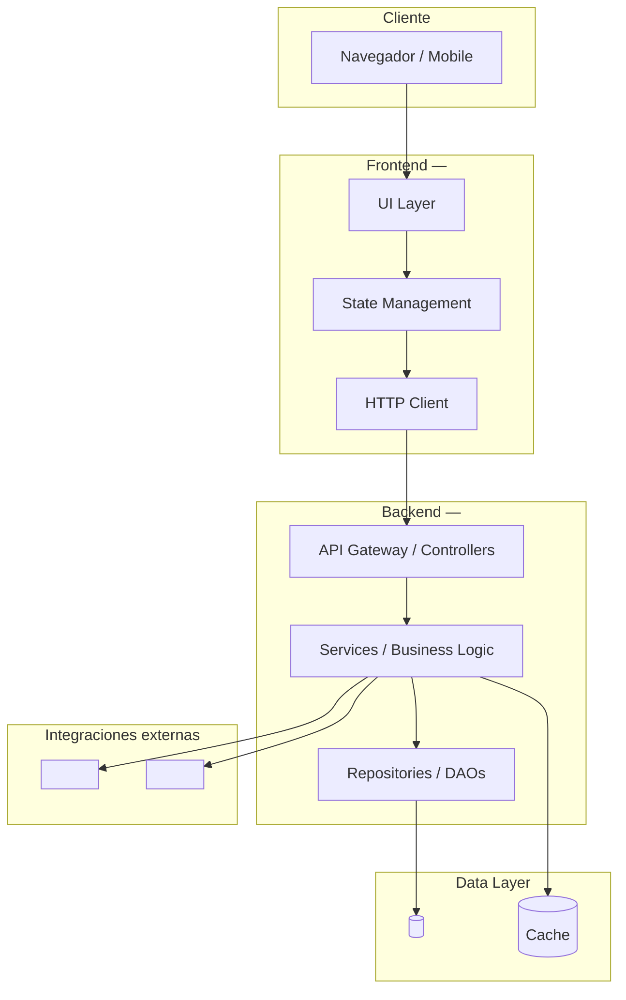
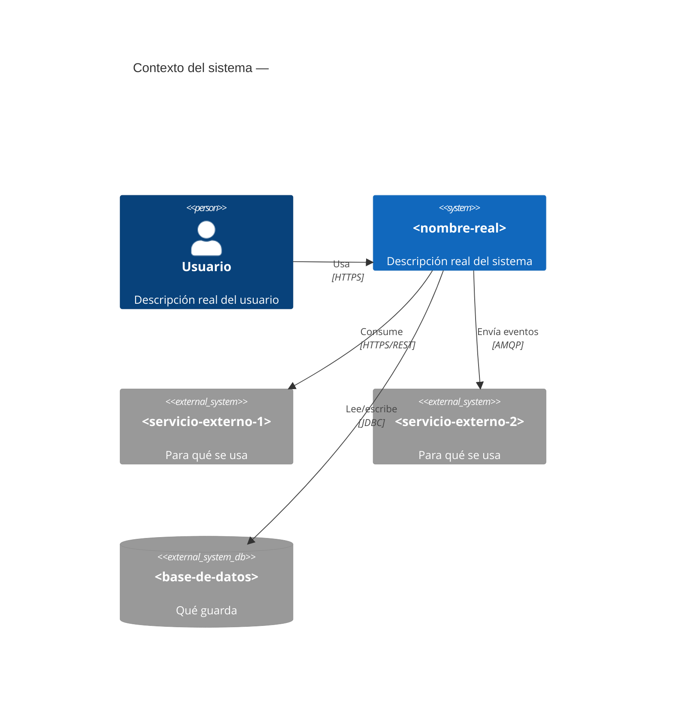
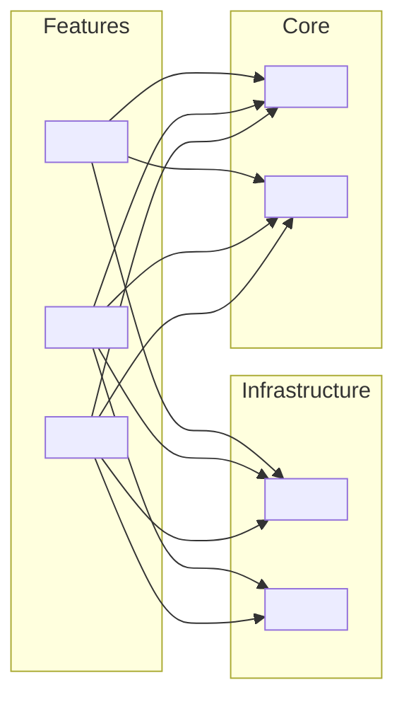
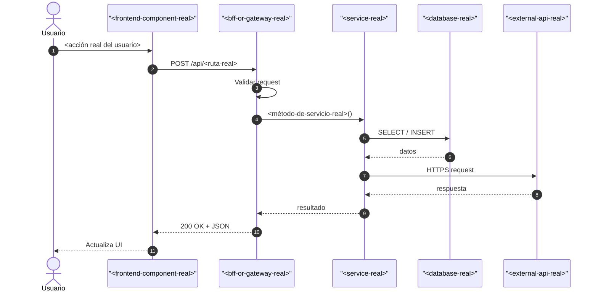
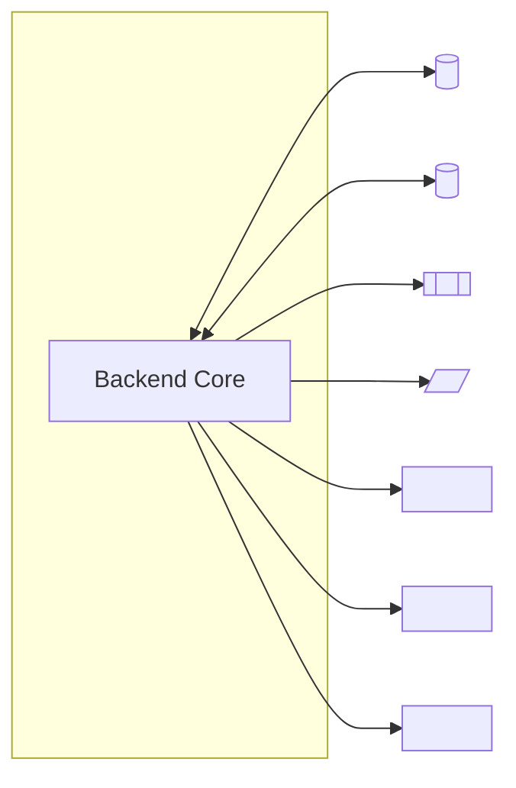
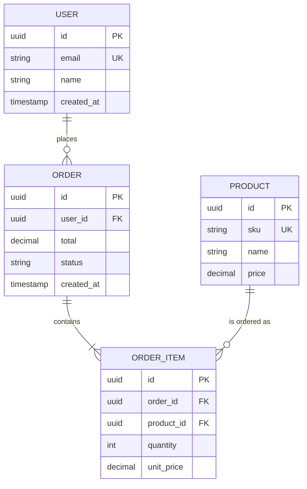
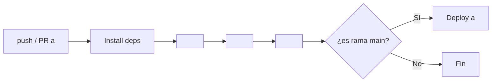

# Mermaid Patterns — Project Documentation

Reference templates for every Mermaid diagram used by `project-docs-generator`. Copy a template, replace the placeholder nodes with real names from the repo, and commit. Never leave placeholder node names in the final document.

All diagrams are declared inside fenced blocks with the `mermaid` language tag. The build script extracts them, renders them to SVG via `mmdc`, and embeds them as images in the PDF.

---

## Architecture overview (section 3)

**When to use**: System has clearly separated layers (UI / BFF / backend / DB).

### Template A — `flowchart TB` with subgraphs



### Template B — `C4Context` (preferred for microservices)



---

## Components diagram (section 4)

**When to use**: Always.

### Template — `flowchart LR` with feature subgraphs



Rule: if the repo has > 20 top-level components, create one subgraph per domain area and limit to max 8 nodes per subgraph.

---

## Main data flow (section 5)

**When to use**: Always.

### Template — `sequenceDiagram`



Rule: every `participant` name must be an actual class/component/service name from the repo.

---

## External integrations (section 6)

### Template — `flowchart` with project as hub



Shape conventions:
- `[("...")]` = database
- `[["..."]]` = queue / message broker
- `[/".../]` = auth provider or external identity
- `["..."]` = REST API or generic external service

---

## Data model (section 8)

### Template A — `erDiagram` (for relational / ORM entities)



Replace every entity and field with real ones found in `*.entity.java`, Prisma schema, TypeORM entities, or `*.model.ts` files.

### Template B — `classDiagram` (for TS interfaces / document models)

```mermaid
classDiagram
    class <EntityRealName1> {
        +string id
        +string field1
        +Date createdAt
        +<method-real-name>()
    }
    class <EntityRealName2> {
        +string id
        +<EntityRealName1> parent
    }
    <EntityRealName1> <|-- <EntityRealName2>
```

---

## CI/CD flow (section 12)

### Template — `flowchart LR`



Read the actual workflow YAML to use real stage names and commands.

---

## Size and splitting rules

- Never let a single diagram exceed 25 nodes.
- If the natural diagram has > 25 nodes, split by domain into 2–3 diagrams with clear titles.
- Every edge must represent a real dependency or call that you can point to a file for.
- If two nodes look like they should be connected but you cannot verify it from the code, leave them disconnected — do not guess.

## Validation tips

Before emitting a diagram, mentally verify:
1. Every arrow `-->` has matching source and target node IDs.
2. Every `subgraph` has a closing `end`.
3. Node labels with spaces or special characters are wrapped in `"..."`.
4. Sequence diagram participant names with special characters are wrapped in `"..."`.
5. No two nodes share the same ID (use suffixes if needed: `db_primary`, `db_replica`).
