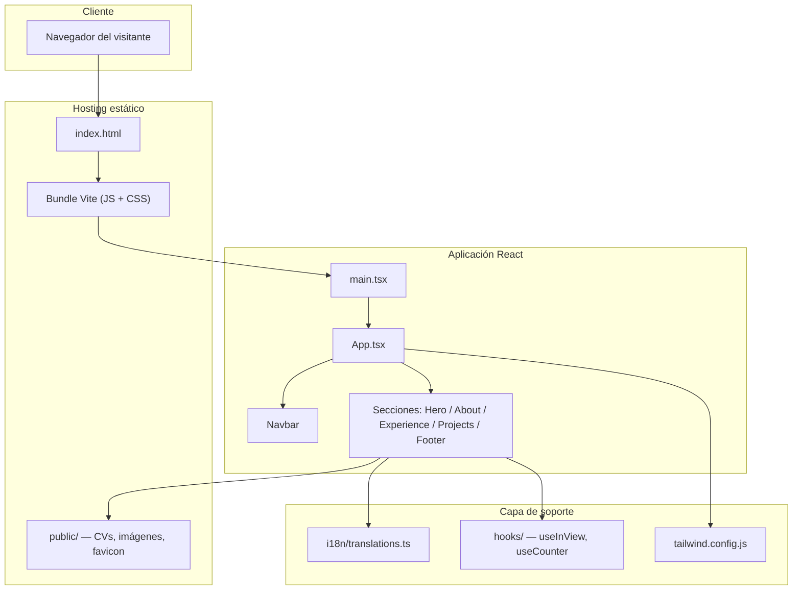
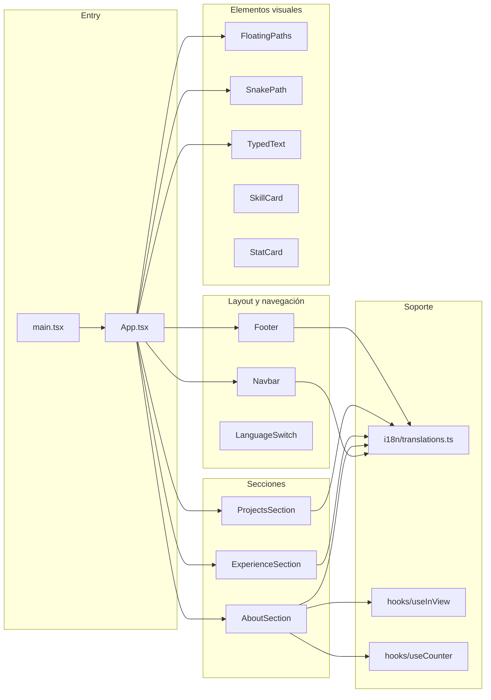
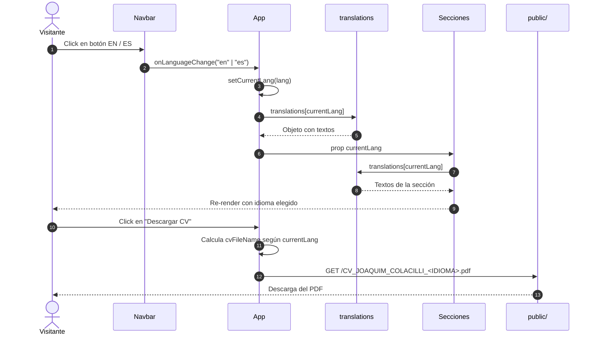
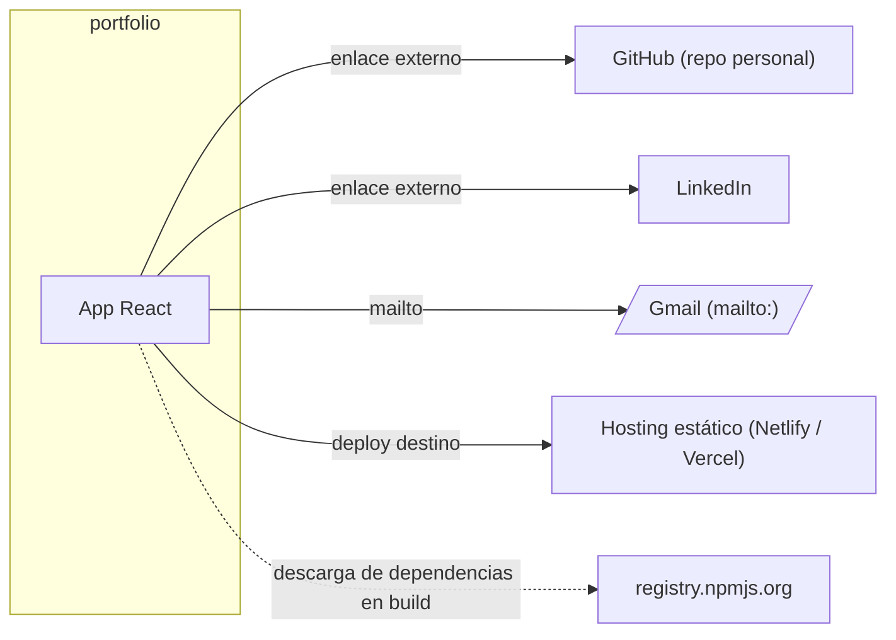
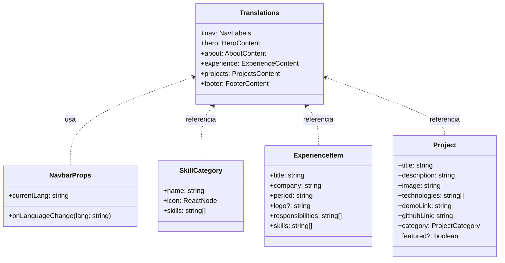

# portfolio

> **Documentación General**
> Versión: 8b80599
> Fecha: 2026-04-09
> Generado por: project-docs-generator skill

---

## 1. Resumen ejecutivo

`portfolio` es el sitio web personal de Joaquim Colacilli (Software Developer). Es una Single Page Application construida con React 18, TypeScript y Vite, que presenta el perfil profesional, experiencia laboral, stack técnico y proyectos destacados del autor. El sitio funciona como carta de presentación digital y canal principal de contacto para oportunidades laborales.

El producto resuelve la necesidad de tener una vitrina profesional unificada, bilingüe (español e inglés), con una experiencia visual rica basada en animaciones fluidas, transiciones con `motion` (antes Framer Motion) y un diseño tipo "bento grid" moderno. Incluye descarga directa del curriculum vitae en ambos idiomas, enlaces a repositorios de GitHub, perfil de LinkedIn y contacto vía email.

El usuario objetivo son reclutadores técnicos, líderes de ingeniería y clientes potenciales de trabajo freelance. La propuesta de valor es transmitir de forma concreta las capacidades técnicas del autor a través de una implementación que funciona como prueba viva de su skillset: React, TypeScript, Tailwind CSS, animaciones performantes y atención al detalle en UX.

## 2. Stack tecnológico

| Capa | Tecnología | Versión | Rol |
|------|------------|---------|-----|
| Frontend | React | ^18.3.1 | Librería principal de UI |
| Frontend | React DOM | ^18.3.1 | Renderizado al DOM |
| Lenguaje | TypeScript | ^5.5.3 | Tipado estático |
| Build tool | Vite | ^5.4.2 | Dev server y bundler de producción |
| Plugin | @vitejs/plugin-react | ^4.3.1 | Integración React + Vite (Fast Refresh) |
| Estilos | Tailwind CSS | ^3.4.1 | Sistema de utilidades CSS |
| Estilos | PostCSS | ^8.4.35 | Procesamiento de CSS |
| Estilos | Autoprefixer | ^10.4.18 | Prefijos vendor automáticos |
| Animación | motion | ^12.38.0 | Animaciones declarativas y gestos |
| Iconos | lucide-react | ^0.344.0 | Set de iconos SVG |
| Fuentes | @fontsource/inter | ^5.2.8 | Tipografía Inter self-hosted |
| Fuentes | @fontsource-variable/jetbrains-mono | ^5.2.8 | Tipografía monoespaciada |
| Linter | ESLint | ^9.9.1 | Análisis estático |
| Linter | typescript-eslint | ^8.3.0 | Reglas TS para ESLint |
| Linter | eslint-plugin-react-hooks | ^5.1.0-rc.0 | Reglas de hooks |
| Linter | eslint-plugin-react-refresh | ^0.4.11 | Reglas de Fast Refresh |
| Package manager | npm | — | Gestor de dependencias |

## 3. Arquitectura de alto nivel



- El punto de entrada para cualquier request del visitante es `index.html`, servido por el host estático (por ejemplo Netlify, Vercel o GitHub Pages). Ese HTML monta el bundle generado por Vite.
- La raíz React se inicializa en `src/main.tsx` con `createRoot(...).render(<StrictMode><App /></StrictMode>)` y carga las fuentes Inter y JetBrains Mono.
- El componente `App` en `src/App.tsx` maneja el estado de idioma (`currentLang`) y compone la `Navbar` con las secciones `Hero`, `AboutSection`, `ExperienceSection`, `ProjectsSection` y `Footer`.
- Los contenidos textuales en dos idiomas viven en `src/i18n/translations.ts`. Los hooks personalizados `useInView` y `useCounter` encapsulan la observación de visibilidad y la animación numérica respectivamente.
- Los recursos estáticos descargables (CVs en PDF, imágenes de proyectos y logos de empresas) se sirven desde la carpeta `public/`, que Vite copia tal cual al directorio final de build.

## 4. Diagrama de componentes



## 5. Flujo principal de datos

El flujo más importante para el usuario es cambiar de idioma y descargar el CV, porque acumula la mayoría de interacciones útiles del portfolio.



## 6. Integraciones externas

No hay un backend propio ni APIs internas. Las integraciones se limitan a recursos externos enlazados desde la UI y registros de npm usados durante el build.



| Sistema | Tipo | Protocolo | Dónde se usa (archivo) | Propósito |
|---------|------|-----------|------------------------|-----------|
| GitHub (perfil) | Enlace externo | HTTPS | `src/components/Footer.tsx`, `src/components/ProjectsSection.tsx` | Enlazar perfil y repositorios de proyectos |
| LinkedIn | Enlace externo | HTTPS | `src/components/Footer.tsx` | Enlazar perfil profesional |
| Gmail | Mailto | `mailto:` | `src/components/Footer.tsx` | Contacto directo por correo |
| registry.npmjs.org | Registro de paquetes | HTTPS | `package-lock.json` | Resolución de dependencias en build |
| Merced Edificio demo | Enlace externo | HTTPS | `src/components/ProjectsSection.tsx` | Demo de proyecto del portfolio |
| Más Fácil Imposible demo | Enlace externo | HTTPS | `src/components/ProjectsSection.tsx` | Demo de proyecto del portfolio |
| Primatech demo | Enlace externo | HTTPS | `src/components/ProjectsSection.tsx` | Demo de proyecto del portfolio |

## 7. API / Endpoints públicos

Este proyecto no expone una API HTTP pública. Es una SPA estática sin backend, por lo que no hay rutas servidas desde el proyecto. La navegación interna se resuelve con anclas HTML (`#home`, `#about`, `#experience`, `#projects`, `#contact`) y se monitorea con `IntersectionObserver` en `src/components/Navbar.tsx`.

## 8. Modelo de datos

El proyecto no usa base de datos. Los datos estáticos que alimentan las secciones están modelados como objetos TypeScript inmutables dentro del código. A continuación se documentan las estructuras principales halladas en los componentes.



- `Translations` es un diccionario `{ en: {...}, es: {...} }` definido en `src/i18n/translations.ts`.
- `SkillCategory` y el arreglo `skillCategories` viven en `src/components/AboutSection.tsx`.
- `ExperienceItem` y la lista de experiencias están en `src/components/ExperienceSection.tsx`.
- `Project` y el catálogo de proyectos están en `src/components/ProjectsSection.tsx`.

## 9. Variables de entorno

No se detectaron archivos `.env`, `.env.example`, `environment.ts` ni propiedades de configuración externa en el repositorio. El proyecto no consume variables de entorno en tiempo de ejecución: todos los textos, imágenes y enlaces están definidos en el código fuente. Ver también la sección `Secciones omitidas` al final del documento.

## 10. Manual de instalación y puesta en marcha

### Prerequisitos del sistema

- Node.js 18 o superior (recomendado 20 LTS, compatible con Vite 5).
- npm 9 o superior (incluido con Node.js).
- Git para clonar el repositorio.
- Opcional: un navegador basado en Chromium para probar en desarrollo.

### Clonar el repositorio

```bash
git clone https://github.com/JoaquimColacilli/portfolio.git
cd portfolio
```

### Instalar dependencias

```bash
npm install
```

### Configurar variables de entorno

No se requieren variables de entorno. El proyecto funciona con la configuración del repositorio tal cual se clona.

### Levantar servicios auxiliares

No aplica: el portfolio no depende de bases de datos, colas ni APIs backend.

### Correr en modo desarrollo

```bash
npm run dev
```

Vite levanta el servidor de desarrollo con Hot Module Replacement en el puerto por defecto (`http://localhost:5173`).

### Correr tests

El proyecto no incluye suite de tests automatizados. Se puede correr el linter como control de calidad estática:

```bash
npm run lint
```

### Build de producción

```bash
npm run build
```

El artefacto generado queda en la carpeta `dist/`, lista para servir en cualquier host estático.

### Previsualización del build

```bash
npm run preview
```

### Deploy

El repositorio no contiene `Dockerfile` ni scripts de deploy. El flujo sugerido es subir la carpeta `dist/` a un proveedor de hosting estático compatible: Netlify, Vercel, Cloudflare Pages o GitHub Pages. La única convención necesaria es preservar la ruta raíz `/` para los assets absolutos referenciados en `index.html` y `App.tsx` (por ejemplo `/CV_JOAQUIM_COLACILLI_ESPAÑOL.pdf`).

## 11. Estructura de carpetas

```text
portfolio/
├── public/                → Assets estáticos servidos tal cual
│   ├── images/            → Imágenes de proyectos, logos de empresas y foto de perfil
│   ├── CV_JOAQUIM_COLACILLI_ENGLISH.pdf
│   ├── CV_JOAQUIM_COLACILLI_ESPAÑOL.pdf
│   ├── jc.ico
│   └── vite.svg
├── src/                   → Código fuente de la aplicación React
│   ├── assets/            → Recursos importados desde el bundle
│   ├── components/        → Componentes React por responsabilidad
│   ├── hooks/             → Hooks personalizados reutilizables
│   ├── i18n/              → Traducciones ES/EN
│   ├── App.tsx            → Componente raíz y layout principal
│   ├── index.css          → Estilos globales y capa Tailwind
│   ├── main.tsx           → Bootstrap de React
│   └── vite-env.d.ts      → Tipos de ambiente de Vite
├── eslint.config.js       → Configuración de ESLint 9 flat config
├── index.html             → HTML raíz para Vite
├── package.json           → Metadatos y scripts del proyecto
├── postcss.config.js      → Configuración de PostCSS
├── README.md              → Descripción breve del proyecto
├── tailwind.config.js     → Configuración de Tailwind CSS
├── tsconfig.json          → Configuración TypeScript raíz
├── tsconfig.app.json      → Config TS específica del bundle de la app
├── tsconfig.node.json     → Config TS para archivos ejecutados en Node (vite.config)
└── vite.config.ts         → Configuración de Vite
```

## 13. Scripts y tareas automatizadas

| Comando | Qué hace | Cuándo usarlo |
|---------|----------|---------------|
| `npm run dev` | Levanta Vite en modo desarrollo con HMR | Durante desarrollo local |
| `npm run build` | Compila TypeScript y genera bundle de producción en `dist/` | Antes de cada deploy |
| `npm run lint` | Ejecuta ESLint sobre todo el proyecto | Validación previa a commit o PR |
| `npm run preview` | Sirve el contenido de `dist/` para probar el bundle compilado | Verificar el build antes de publicar |

## 15. Glosario de términos del dominio

- **Hero** — Sección superior del landing que contiene el saludo, nombre animado, rol y botones de acción principal.
- **Bento grid** — Patrón de diseño usado en `AboutSection` que combina tarjetas de distintos tamaños para mostrar información densa (stats, ubicación, educación, stack).
- **White-label** — Modelo de producto mencionado en la experiencia laboral; describe micrositios parametrizables para partners externos.
- **Cross Selling** — Iniciativa de producto en Despegar donde el autor trabaja actualmente; se refiere a ventas cruzadas entre verticales de viaje.
- **SPA** — Single Page Application: la arquitectura de este portfolio, donde todo el contenido se carga en una única página y la navegación se resuelve con anclas internas.
- **Fast Refresh** — Característica de `@vitejs/plugin-react` que actualiza componentes en caliente sin perder estado durante desarrollo.
- **IntersectionObserver** — API del navegador usada por los hooks `useInView` y por la `Navbar` para detectar qué sección está en viewport y resaltar el enlace activo.

## 16. Ownership y contactos

- **Autor principal**: Joaquim Colacilli
- **Email**: joaquimcolacilli9@gmail.com (fuente: `src/components/Footer.tsx`)
- **GitHub**: https://github.com/joaquimcolacilli
- **LinkedIn**: https://linkedin.com/in/joaquim-colacilli
- **Ubicación**: Buenos Aires, Argentina (fuente: `src/components/AboutSection.tsx`)
- **Committers registrados en git**: Joaquim, Joaquim Colacilli

El repositorio no contiene archivo `CODEOWNERS`. El campo `author` de `package.json` está ausente, por lo que el ownership se deriva del historial git y del contenido del propio sitio.

## 17. Apéndice — Evidencia

### React
- `package.json` (dependencia: `react`, `react-dom`)
- `src/main.tsx` (import de `react-dom/client`)
- `src/App.tsx` (componentes funcionales)

### TypeScript
- `package.json` (devDependency: `typescript`, `typescript-eslint`)
- `tsconfig.json`
- `tsconfig.app.json`
- `tsconfig.node.json`

### Vite
- `package.json` (devDependency: `vite`, `@vitejs/plugin-react`)
- `vite.config.ts`

### Tailwind CSS
- `package.json` (devDependency: `tailwindcss`, `postcss`, `autoprefixer`)
- `tailwind.config.js`
- `postcss.config.js`
- `src/index.css`

### motion (animaciones)
- `package.json` (dependencia: `motion`)
- `src/App.tsx` (`useScroll`, `useTransform`, `motion.div`, `AnimatedLetters`)
- `src/components/Navbar.tsx` (`motion`, `AnimatePresence`)
- `src/components/AboutSection.tsx`
- `src/components/ExperienceSection.tsx`
- `src/components/ProjectsSection.tsx`
- `src/components/Footer.tsx`

### lucide-react
- `package.json` (dependencia: `lucide-react`)
- `src/App.tsx` (`ChevronDown`, `Download`)
- `src/components/Navbar.tsx` (`Menu`, `X`)
- `src/components/Footer.tsx` (`Mail`, `Github`, `Linkedin`, `Copy`, `Check`, `ExternalLink`)

### Fuentes web self-hosted
- `package.json` (dependencias: `@fontsource/inter`, `@fontsource-variable/jetbrains-mono`)
- `src/main.tsx` (imports de los CSS de las fuentes)

### ESLint 9 (flat config)
- `package.json` (devDependency: `eslint`, `@eslint/js`, `eslint-plugin-react-hooks`, `eslint-plugin-react-refresh`)
- `eslint.config.js`

### npm
- `package.json`
- `package-lock.json`

### Contenido i18n
- `src/i18n/translations.ts` (objeto `translations` con claves `en` y `es`)

### Hooks personalizados
- `src/hooks/useInView.ts` (wrapper sobre `IntersectionObserver`)
- `src/hooks/useCounter.ts` (contador animado con `requestAnimationFrame`)

### Assets descargables
- `public/CV_JOAQUIM_COLACILLI_ENGLISH.pdf`
- `public/CV_JOAQUIM_COLACILLI_ESPAÑOL.pdf`
- `public/images/` (imágenes de proyectos y logos de empresas)

---

## Secciones omitidas

- **9. Variables de entorno** — Se documentó como vacía porque el proyecto no consume variables de entorno: no existen archivos `.env`, `.env.example`, `environment.ts` ni configuraciones externalizadas. Se deja el encabezado por completitud.
- **12. CI/CD** — No se detectaron workflows en `.github/workflows/` ni `Jenkinsfile`, `.gitlab-ci.yml` u otros marcadores de pipelines en el repositorio.
- **14. Troubleshooting** — No existe archivo `TROUBLESHOOTING.md` y el `README.md` del proyecto tiene una única línea descriptiva sin incidencias conocidas documentadas.
